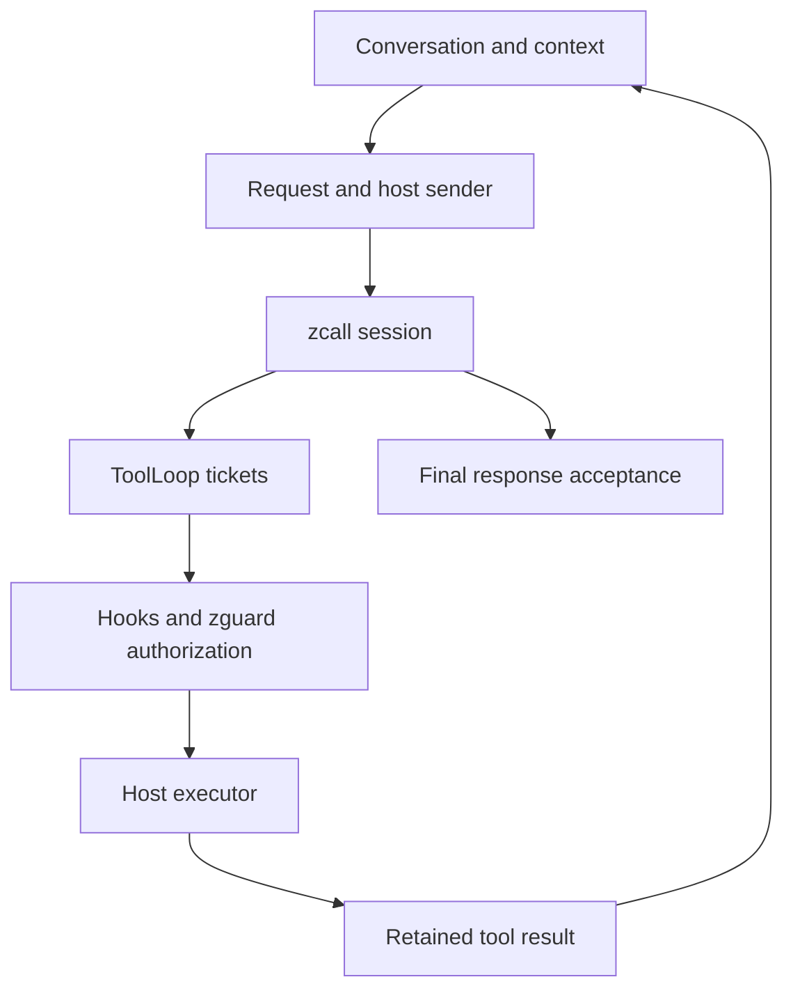

# Architecture

The application owns external work. zharness supplies bounded state transitions;
zcall owns model protocols, IR, streaming aggregation and lifecycle. All zcall
integration uses public v1 APIs. No provider-specific fields or MCP source are
parsed by the harness components.

The guarded tool path preserves application-owned I/O and result retention:

Context retains borrowed message groups, caller token costs and explicit summaries.
Whole-group eviction preserves correctly grouped tool exchanges. Forks copy only
descriptors. Token estimates, semantic summaries and payload lifetime remain caller
contracts; the core does not create a tokenizer, storage system or summarizer.

ToolLoop separates stream observation from execution. Genuine ToolReady events
are retained in fixed slots, and the terminal WaitingTools outcome permits dispatch.
The application owns concurrent work and retains results/history before clearing
per-turn storage. Original call IDs and run/round tickets reject mismatched or
stale completions without a hidden cross-system transaction.

Existing Hooks methods gate/observe native operations without changing their
semantics. Typed lifecycle channels extend coverage independently rather than
appending dozens of methods to that trait. Gate controls proposals; Interceptor
edits a copy before validation/gating; Observer records metadata by default.
The non-cloneable Span receipt supports explicitly bracketed async work without
requiring Futures, threads or a runtime in the core. All identities and retained
receipt storage are supplied/owned by the caller.

Conversation and ModelSettings make their local state changes only on accepted
operations. These do not globally observe UI changes or reconfigure in-flight
model calls. Sender acceptance is adapter-defined, not proof of server receipt.
ResponseStream receives original zcall events and honors event rejection/replay;
first visible output, terminal outcome and final message acceptance remain
separate. WaitingTools and failures cannot be finalized as successful replies.

TaskBoard stores descriptors, not agent workers. Topological dependencies, one
active lease per agent, attempt/epoch fencing and explicit expiry give a bounded
coordination layer. Leases do not revoke already-started external effects or
provide distributed consensus/exactly-once delivery. Mailboxes need caller-owned
synchronization and transport when used across threads or machines.

Lifecycle::run can surround prompt construction, database writes, checkpoints,
policy checks, retries and worker operations. A label/notification alone performs
none of those tasks. Native wrappers and explicitly application-wrapped boundaries
are enumerated separately in LIFECYCLE.md. Error propagation never implies rollback
of external effects or permission for a blind retry. Panics are not caught.

The direct runtime dependencies are zcall 0.4.0, zplugin 0.3.1 and zguard 0.1.0.
zcall uses zconv 0.4.0; zplugin shares native loading through zsys 0.1.1.
zguard has no Cargo dependencies. zplugin-macros and its parser dependencies run
during compilation. The optional Wasm feature adds its separately audited engine;
there is no MCP repository dependency.

The guard owns per-session authorization state. Prepared and Command guarded
methods retain exact request identity and feed it to zguard before invoking user
code. Default denial, one-use host approvals, limits and metadata audit are part
of that boundary. Existing low-level adapter methods keep their explicit host
permission contract. See GUARDRAILS.md for the complete integration path.

Native extensions use zplugin's real loader and generated v1 interface. The
interface passes an operation name, input bytes and caller output storage, with
no prescribed payload format. ExtensionProxy checks output sizes and optionally
UTF-8; its Executor implementation passes validated tool arguments unchanged.
Prepared's guarded execution methods check policy and audit before the actual
native call; existing hooks retain their independent callbacks. The proxy
borrows its library, so object destruction precedes unloading. Trust decisions,
operation meaning, tool registration, scheduling and reload policy are explicit
host responsibilities. The core contains no handwritten FFI or unsafe block.

Skills have a separate metadata and filesystem boundary. SkillMetadata borrows
frontmatter and summary writers use caller buffers without alloc or I/O. The
optional std SkillPaths adapter reads explicitly configured directories and keeps
only metadata in a SkillCatalog. An ordered root list determines name precedence;
an index accelerates lookup without duplicating owned names. A chosen skill loads
its instructions and resources on demand. The application decides prompt placement,
activation and tool permissions; discovery never starts a process or model call.
