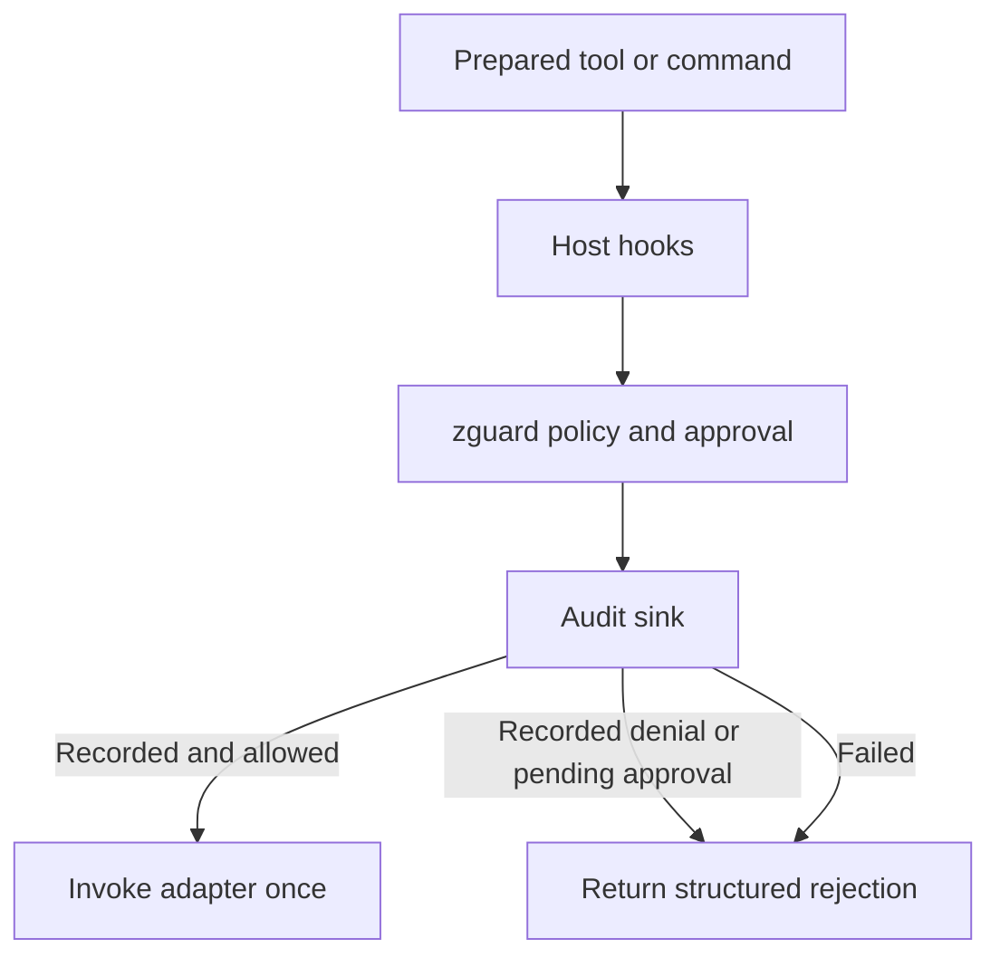

# Native security guardrails

zharness directly depends on zguard and exposes it as `zharness::zguard`.
The `guard` module connects deterministic host policy to actual tool and command
execution. Each accepted call passes policy, approval, quota and audit checks
before the adapter receives it.

## Execution boundary

Use `Prepared::execute_guarded` or `Command::execute_guarded` with an
`Authorization` containing a persistent session guard, an audit sink and the
current host clock value. The `_with_hooks` variants preserve existing hooks.
A hook can reject or pause first; the guard then checks immediately before the
underlying adapter runs.



Only `Decision::Allow` reaches the adapter. Deny and RequireApproval return
`Error::Guard(Verdict)` for tools or `CommandError::Guard(Verdict)` for commands.
The bounded verdict contains a decision, a reason and an optional rule ID; it
does not contain arguments or outputs. Hooks observe guard rejections through
the existing execution-error callback. Output buffers remain untouched when
the guard rejects.

The call is checked and executed with the same data. For a prepared tool, the
request uses its actual call ID, name and `Arguments::as_bytes()`. These are the
validated JSON object bytes delivered to the executor; the JSON parser removes
whitespace surrounding the object. Commands retain the exact call ID, program,
argv element boundaries and optional working directory. No concatenation or
hash approximates the approved command.

## Host-owned policy and approvals

Create rules from trusted application configuration. Rules match exact names
within either the Tool or Command namespace. Empty policies and unmatched calls
are denied. Explicit denial wins over approval requirements and allow rules.
Capabilities come from the host context; argument fields such as
`approved: true`, tool descriptions, skill instructions and MCP annotations do
not alter that context.

A trusted host issues an approval with `Guard::approve` after reviewing an exact
request. The approval borrows that request, the complete immutable policy and
the session context. It is neither Copy nor Clone and is consumed by one
authorization attempt. A changed call ID, argument byte, argv boundary, cwd,
policy or session fails the binding check. Expired approvals and clock
regressions fail closed. The host supplies monotonic clock values in one
consistent unit and a fresh session epoch when recreating the guard.

`Authorization` and the two executor wrappers are single-attempt values.
A wrapper consumes its authorization on entry, including an invalid command.
Calling it again returns InvalidState without rechecking, spending another
budget unit or reusing an old clock value. Construct a new authorization for
another attempt while retaining the same Guard. Hook pauses consume the supplied
authorization value without reserving an execution quota; the host decides
whether its external approval evidence still applies when it prepares a retry.

## Integration choices

The native methods provide the shortest path for a prepared call:

```rust,ignore
let result = prepared.execute_guarded(
    &mut executor,
    &mut output,
    Authorization::new(&mut guard, &mut audit, now),
)?;
```

The complete, compiled [guarded_execution example](examples/guarded_execution.rs)
uses an in-memory adapter. It demonstrates a model-supplied approval field being
rejected, an explicit host-issued approval and a single accepted execution:

```sh
cargo run --locked --example guarded_execution
```

`GuardedExecutor` and `GuardedCommandExecutor` also implement the existing
executor traits. Use them when an existing caller already dispatches through
those traits. A direct GuardedExecutor user supplies the actual call ID.
Choose the native method or an explicit wrapper for one boundary; the native
method already wraps its adapter. Explicitly nesting different guards evaluates
each host policy separately.

A plugin Router implements Executor, so passing the router to
`Prepared::execute_guarded` checks the public tool name before resolving a backend
operation. The same path applies to native proxies, Wasm extensions and a
host-supplied MCP Executor. zharness supplies no MCP transport. Native plugin
loading and direct `call_bytes`/`call_text` remain trusted host operations.
Existing `Prepared::execute`, `execute_with_hooks` and raw adapter methods retain
their explicit host-authorization contract; select the guarded boundary to
enforce zguard policy.

## Quotas, audit and adapter failures

A persistent Guard caps authorized attempts and each request's input bytes.
Quota reservation precedes the adapter, so an adapter error, nonzero command exit
or invalid result never refunds the attempt or replays the approval. Retry
decisions, external idempotency and recovery remain application-owned.

The audit sink receives only numeric session/policy/sequence identifiers, action
kind, payload byte count and the verdict. Names, call IDs, raw arguments and
outputs are absent. A sink error prevents invocation. Durability, access control
and log retention belong to that sink. `NoAudit` is an explicit opt-out chosen by
the host; the library writes no files or telemetry.

The guard controls entry to an adapter. An allowed shell or program can exercise
its complete privileges unless the host also applies argument/resource policy
and operating-system isolation. Native-library initializers run during loading,
before guarded operation dispatch. Use the existing Wasm backend or an OS sandbox
for untrusted code.

## Verification

`tests/guard.rs` exercises real preparation, wrappers and plugin routing with
side-effect counters and untouched-buffer assertions. It covers:

| Contract | Evidence |
| --- | --- |
| Rejections precede adapter calls | Empty policy, approval requirement, expiry and audit-failure cases |
| Approval follows the actual request | Real call ID, exact executed JSON, program, argv boundaries and cwd changes |
| Model data grants no permission | Forged approved/capabilities fields |
| Quotas survive adapter failure | Failed executor followed by an exhausted-budget rejection |
| Native methods check once | One accepted call, one audit event and one reserved call |
| Single-attempt values cannot replay | Tool wrapper reuse and invalid command followed by wrapper reuse |
| Plugin policy uses the public identity | Real Router dispatch test |
| Existing result behavior is preserved | Business tool error and nonzero command exit tests |

Run the focused integration checks and dependency audit:

```sh
cargo test --locked --test guard
cargo check --locked --no-default-features --target wasm32-unknown-unknown
python3 scripts/audit.py
```

The dependency audit includes zguard in the Project Z runtime closure.
zguard adds no Cargo dependencies, allocator or operating-system runtime.
The verification above covers policy enforcement in these explicit library
entry points; each consuming application's actual dispatch path needs its own
acceptance check.
